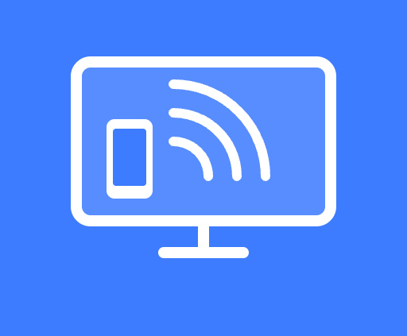
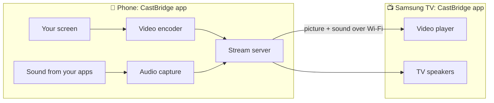
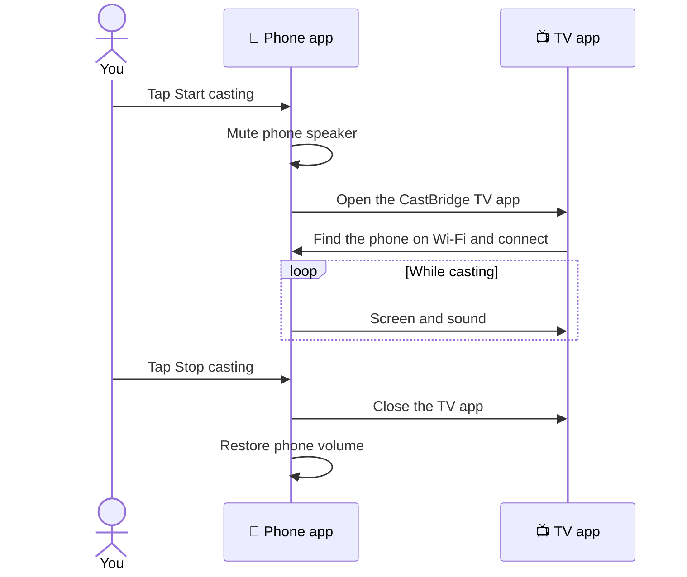

# CastBridge

**Show your Android phone on your Samsung TV, with sound.**

Some Android phones, like Google Pixels, can't mirror their screen to Samsung TVs. CastBridge
fixes that: tap one button on your phone and your screen appears on the TV, with the sound
coming from the TV's speakers.

> **Have a Samsung, Xiaomi, OnePlus or Oppo phone?** You may not need this. Try your phone's
> built-in *Smart View* / *Screen Cast* first.

---

## What you need

- An **Android phone** (Android 10 or newer)
- A **Samsung smart TV** from 2021 or newer (tested on a 2021 Q60A)
- A **computer**, only for the one-time TV setup (about 20 minutes, mostly waiting for downloads)
- A free **Samsung account**
- Phone, TV and computer on the **same Wi-Fi**

---

## Install on your phone

1. Get the app file, **castbridge-release.apk**, either way:
   - Once CastBridge is on your TV, point your phone's camera at the **QR code** on the TV screen, or
   - on your phone, open **[this download link](../../releases/latest/download/castbridge-release.apk)**.
2. Open the downloaded file and tap **Install**.
   - If your phone asks, allow your browser to *install unknown apps*.

---

## Install on your TV (one time)

### Step 1: Download CastBridge to your computer

On this page, click the green **Code** button › **Download ZIP**, then unzip it.

### Step 2: Turn on Developer Mode on the TV

This lets your computer install CastBridge on the TV.

1. Turn on the TV and open **Apps**.
2. On the remote, press **1 2 3 4 5**. A *Developer Mode* window opens.
3. Switch **Developer mode** to **On**.
4. For **Host PC IP**, enter your computer's IP address. The installer in step 3 tells you what
   it is, so you can come back to this.
5. Restart the TV: hold the power button on the remote until the TV turns off and on again.

### Step 3: Run the installer

1. Start the installer from the unzipped folder:

   | Computer | How |
   |---|---|
   | **Mac** | Right-click `Install on TV.command` › **Open** › **Open**. |
   | **Linux** | Open a terminal in the folder and run `bash tizen/setup-tv.sh` |
   | **Windows** | The guided installer isn't available on Windows yet. |

2. The installer guides you through the rest. It will:
   - find your TV,
   - download Samsung's free TV tools,
   - open a window where you **sign in to your Samsung account** to create a certificate for
     your TV. Follow the steps the installer shows you,
   - install CastBridge on the TV.
3. When it says **Done!**, CastBridge is in your TV's **Apps** list.

---

## Use it

1. Open **CastBridge** on your phone.
2. Pick your TV and tap **Start casting** › **Entire screen**.
3. Your phone appears on the TV within a few seconds. The sound plays on the TV.
4. Tap **Stop casting** when you're done. The TV goes back to what it was showing.

---

## How it works

Your phone and TV talk directly over your home Wi-Fi. Nothing goes through the internet.

What happens when you tap **Start casting**:

---

## Something not working?

| Problem | Try this |
|---|---|
| The phone can't find the TV | Make sure both are on the same Wi-Fi and the TV is on. The app keeps looking by itself; you can also tap the refresh button. |
| The TV doesn't open CastBridge by itself | Open **CastBridge** from the TV's **Apps** list. It connects as soon as you start casting. |
| The TV says "Connection to your phone was lost" | Your phone left the Wi-Fi or changed network. Reconnect it to the TV's Wi-Fi; CastBridge picks up again by itself. |
| No sound on the TV | Press any button on the TV remote once. |
| One app shows a black screen | Netflix, Prime Video and similar apps block screen sharing. That's normal. |
| The installer can't connect to the TV | Check the TV is on and Developer Mode's **Host PC IP** matches your computer's IP, then restart the TV. |
| CastBridge disappeared from the TV | A TV update can remove it. Run the installer again. |
| It feels a bit delayed | Normal: the TV shows your phone about half a second late. Not great for fast games. |

---

## Privacy

CastBridge collects nothing. Your screen and sound go straight from your phone to your TV over
your home Wi-Fi. See the [privacy policy](docs/PRIVACY.md).

## Credits

Uses [jmuxer](https://github.com/samirkumardas/jmuxer) and
[qrcode-generator](https://github.com/kazuhikoarase/qrcode-generator) (both MIT)
